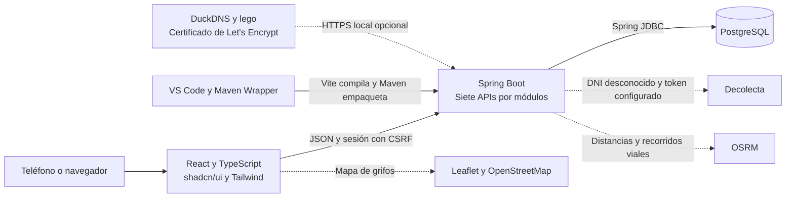

# Services Vales

Aplicación para gestionar vales de combustible, con siete APIs por módulos en una aplicación Spring Boot y una interfaz React adaptada a teléfonos.

## Instalar y ejecutar

1. Instalar **JDK 17 o superior**, **PostgreSQL 18** con sus herramientas de línea de comandos y **VS Code** con **Extension Pack for Java**.
2. Abrir la carpeta raíz en VS Code y habilitar la confianza del espacio de trabajo.
3. En **Ejecutar y depurar**, seleccionar **Ejecutar Services Vales** y pulsar **▶**.
4. Esperar la compilación y la apertura del navegador. El primer arranque crea `.env`, prepara una instancia privada de PostgreSQL y carga los datos de prueba. Maven descarga Node.js, npm y las dependencias de React.
5. Ingresar con **demo.operativo.piura** y contraseña **demo**. Para detener Vales, pulsar **Shift + F5**.

Dirección predeterminada [http://127.0.0.1:8080](http://127.0.0.1:8080). El primer arranque requiere Internet. Si PostgreSQL está instalado en otra ruta, la variable de entorno `VALES_PG_BIN` debe apuntar a su carpeta `bin`.

El modo predeterminado `VALES_DB_MODE=local` conserva sus archivos en `.local/` y aplica migraciones pendientes al arrancar. No modifica el servidor del puerto 5432.

### Usar PostgreSQL en el puerto 5432

1. Crear una base **vacía** llamada `services_vales` desde pgAdmin.
2. Ejecutar el instalador con la cuenta propietaria desde la raíz del proyecto:

   ```powershell
   & "C:\Program Files\PostgreSQL\18\bin\psql.exe" -h 127.0.0.1 -p 5432 -U postgres -d services_vales -v ON_ERROR_STOP=1 -f backend/src/main/resources/db/instalar-demo.sql
   ```

3. Copiar `.env.example` a `.env`, si todavía no existe, y completar:

   ```properties
   VALES_DB_MODE=externa
   VALES_DB_URL=jdbc:postgresql://127.0.0.1:5432/services_vales
   VALES_DB_USER=postgres
   VALES_DB_PASSWORD=contraseña_de_su_PostgreSQL
   VALES_DNI_PROVIDER=demo
   VALES_DNI_TOKEN=
   ```

4. Ejecutar el perfil de VS Code.

Las credenciales de `.env` corresponden al PostgreSQL de esa PC. Las cuentas `demo.*` se utilizan en la pantalla de ingreso de Vales. El instalador solo admite bases vacías. Para actualizar una base con registros, se respalda y se aplican únicamente sus migraciones pendientes como propietario. Una cuenta de conexión limitada puede recibir el rol `vales_app`; `postgres` facilita la instalación de desarrollo.

## Preparar el despliegue en Railway

El [Dockerfile](Dockerfile) compila React y lo empaqueta con Spring Boot. En Railway se necesita un proyecto con dos servicios, Vales y PostgreSQL. Conserva la raíz del repositorio como directorio de compilación, ya que Maven usa `backend/` y `frontend/`.

1. Sube el código, las migraciones de `backend/src/main/resources/db/`, `frontend/package-lock.json`, el Maven Wrapper, los archivos Docker y `.env.example`. Mantén `.env`, `.local/`, las fuentes privadas y las carpetas generadas fuera del repositorio.
2. Prepara el esquema de PostgreSQL antes de publicar Vales. Para conservar los registros de una instalación, restaura su respaldo en privado y prepara un usuario de conexión con los permisos de `vales_app`. Consulta la [guía de base de datos](docs/base-datos-vales.md).
3. Genera un dominio público para Vales y configura estas variables en su servicio. Cambia `Postgres` si el servicio de base de datos tiene otro nombre.

   ```dotenv
   VALES_DB_MODE=externa
   VALES_DB_URL=jdbc:postgresql://${{Postgres.PGHOST}}:${{Postgres.PGPORT}}/${{Postgres.PGDATABASE}}
   VALES_DB_USER=vales_conexion
   VALES_DB_PASSWORD=contraseña_del_usuario_de_conexión
   VALES_PUBLIC_BASE_URL=https://tu-dominio.up.railway.app
   VALES_SECURE_COOKIES=true
   VALES_HTTPS_ENABLED=false
   SERVER_FORWARD_HEADERS_STRATEGY=framework
   ```

Vales toma el puerto de `PORT` en Railway, salvo que se defina `VALES_PORT`. Railway termina HTTPS en su proxy. El dominio público se usa en los QR y enlaces de reportes. [Guía de despliegue](https://docs.railway.com/quick-start) y [conexión privada a PostgreSQL](https://docs.railway.com/databases/postgresql).

## Probar el flujo completo

| Perfil | Cuenta | Acción |
| --- | --- | --- |
| Operativo | `demo.operativo.piura` | Registrar un vale para Los Algarrobos con 2 galones y un vehículo habilitado. |
| Jefatura | `demo.jefe.piura` | Seleccionar el vale y confirmar su autorización. |
| Atención | `demo.grifo.algarrobos` | Consultar el vale, verificar DNI `90000001`, registrar 1.50 galones y confirmar. |
| Grifo | `demo.grifo.algarrobos` | Seleccionar el ticket en Facturas del grifo y emitir la factura simulada. El número y total se generan automáticamente. |
| Contabilidad | `demo.contabilidad` | Seleccionar el vale usado, elegir la factura y asociar cuando coincidan tickets e importe. Consultar el gasto en el mes del consumo. |
| Administrador | `demo.admin` | Configurar cuentas, roles, tarifas, precios faltantes de contrato y zonales base de vehículos. |

Todas estas cuentas usan la contraseña de prueba **demo**. El emisor puede anular vales propios antes del despacho. PDF del vale muestra el documento y el historial actualizado.

Jefatura programa los lugares de trabajo desde **Configuración → Rutas de trabajo**. Un operativo puede tener varias rutas asignadas. La varita junto al campo **Grifo** abre el comparador, donde elige la ruta, revisa el origen y pulsa **Generar mejor opción** para comparar combustible y desvío vial. La ruta utilizada queda guardada con el vale. Consulta el [ejemplo y la configuración del motor vial](docs/rutas-trabajo.md).

## Stack y conexión



Spring Boot sirve React y las APIs desde el mismo origen. Spring Security administra la sesión y CSRF. PostgreSQL conserva las relaciones, los permisos por perfil y ámbito, los correlativos y las validaciones transaccionales. Los siete módulos se ejecutan en un proceso y utilizan una base de datos.

| Bloque | Carpeta o herramienta | Función |
| --- | --- | --- |
| Frontend | `frontend/src/features/` | Pantallas organizadas por servicio y administración. |
| Frontend | `frontend/src/components/` | Tarjeta de vale, tablas, formularios, navegación y componentes shadcn reutilizables. |
| Frontend | `frontend/src/lib/` | Cliente HTTP con CSRF, tipos TypeScript, importes, QR y PDF comparativo. |
| Frontend | TanStack Query | Consultas y actualización de datos después de cada operación. |
| Frontend | `frontend/public/` | Manifiesto PWA, caché de recursos públicos y bibliotecas del PDF. |
| Backend | `modulos/<servicio>/api/` | Controladores y DTO de las solicitudes y respuestas HTTP. |
| Backend | `modulos/<servicio>/aplicacion/` | Casos de uso y transacciones. |
| Backend | `modulos/<servicio>/dominio/` | Modelos propios cuando el caso de uso los requiere. |
| Backend | `modulos/<servicio>/infraestructura/` | Consultas parametrizadas a PostgreSQL. Los módulos colaboran mediante servicios y no acceden a repositorios ajenos. |
| Backend | `modulos/identidad/` y `modulos/administracion/` | Sesión, DNI y configuración compartida. |
| Backend | `config/`, `compartido/` y `local/` | Seguridad, errores, configuración, arranque y migraciones de la instancia privada. |
| Base de datos | `backend/src/main/resources/db/` | Migraciones numeradas, instalador y datos de prueba. |
| Compilación | Vite y Maven Wrapper | Generación del frontend e incorporación al JAR de Spring Boot. |
| HTTPS local | DuckDNS, lego y Let's Encrypt | Subdominio, validación DNS y certificado para usar la cámara del teléfono. |

Las rutas Java parten de `backend/src/main/java/com/servicesvales/`.

### Siete APIs

| Módulo | Ruta principal | Función |
| --- | --- | --- |
| `emision` | `POST /api/v1/emision/vales` | Registrar modalidad, precio aplicable, centro y vehículo. |
| `autorizacion` | `POST /api/v1/autorizacion/vales` | Autorizar un lote de la zonal de Jefatura. |
| `atencion` | `POST /api/v1/atencion/vales/{uuid}/atencion` | Verificar DNI, registrar el despacho y generar ticket. |
| `facturacion` | `POST /api/v1/facturacion/grifo` y `/api/v1/facturacion/facturas/{id}/vales` | Emitir la factura simulada y conciliarla desde Contabilidad. |
| `anulacion` | `POST /api/v1/anulacion/vales/{id}` | Anular un vale propio sin atención. |
| `documentos` | `GET /api/v1/documentos/{uuid}` | Consultar datos actuales del detalle, QR y PDF. |
| `gastos` | `GET /api/v1/gastos?mes=AAAA-MM-01` | Consultar consumos facturados por mes. |

Se conservan las rutas anteriores para compatibilidad.

## Funciones de apoyo

- **Comparar grifos.** Pulsa la varita junto a **Grifo**, elige la ruta y ajusta el origen si hace falta. **Generar mejor opción** muestra el recorrido por el grifo que minimiza el costo estimado de combustible y desvío. **Elegir grifo** aplica la recomendación al formulario.
- **Conciliación asistida.** Sugiere vales por tickets y exige el conjunto exacto y el total a dos decimales.
- **Seguimiento.** Comparte QR, responsables y fechas en el detalle del vale.
- El navegador recuerda el menú y la vista del comparativo de gastos en `localStorage`. `sessionStorage` conserva los campos del borrador de emisión durante la sesión. El borrador excluye el DNI, el destino y las observaciones.
- TanStack Query reutiliza temporalmente las lecturas en memoria. Los cambios guardados actualizan las consultas afectadas y PostgreSQL valida cada operación. **Actualizar datos** fuerza una consulta nueva.
- El uso móvil incluye tarjetas, lector QR y PWA. Las operaciones que guardan cambios requieren conexión y confirmación.

### Consulta de DNI

El modo `demo` consulta primero el catálogo y permite probar **99000001 → Ana Torres Rojas** y **99000002 → Luis Rivera Prado** como personas ficticias. Emisión S/C consulta el DNI del tercero antes de registrar. Atención consulta el DNI presentado y mantiene la verificación del documento original.

Para usar el proveedor externo, configurar en `.env` y reiniciar:

```properties
VALES_DNI_PROVIDER=decolecta
VALES_DNI_TOKEN=token_de_su_cuenta
```

La integración utiliza el [endpoint documentado de Decolecta](https://decolecta.gitbook.io/docs/servicios/integrations-2). Su disponibilidad depende del proveedor y de la cuenta. El token se utiliza únicamente en el backend. No se necesita una API externa para probar con personas ficticias.

## Comprobaciones

```powershell
# Compilar frontend y backend juntos
.\mvnw.cmd -f backend/pom.xml package

# Verificar límites entre módulos
node backend/src/test/arquitectura.mjs

# Probar frontend, con Node.js 24 instalado
cd frontend
npm ci
npm test
```

Las pruebas SQL están en `backend/src/test/sql/`. Para `reglas.sql` y la prueba HTTP, prepara una base nueva de pruebas con `instalar-demo.sql`. La prueba HTTP `backend/src/test/api/flujo.mjs` solo admite el puerto `18085`.

## Guías

- [Uso y cuentas de prueba](docs/guia-proyecto.md)
- [Flujos de los servicios](docs/flujos-vales.md)
- [Base y datos de prueba](docs/base-datos-vales.md)
- [Relaciones de la base](docs/diagrama-base-datos.md)
