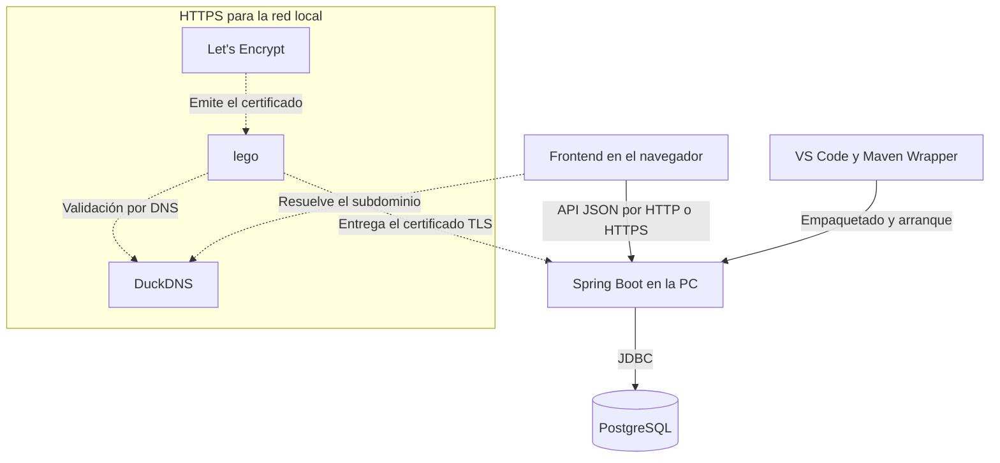

# Services Vales

## Instalación local en Windows

1. Instalar **JDK 17 o superior**, **PostgreSQL 18** y **VS Code** con la extensión **Extension Pack for Java**. PostgreSQL debe incluir sus herramientas de línea de comandos.
2. Clonar o descargar el repositorio y abrir su carpeta raíz en VS Code. Si aparece **Modo restringido**, habilitar la confianza del espacio de trabajo.
3. En **Ejecutar y depurar**, seleccionar **Ejecutar Services Vales** y pulsar **▶**. En el primer arranque, VS Code crea `.env` desde `.env.example` y Vales carga los datos de prueba. Maven necesita Internet para descargar las dependencias.
4. En el navegador, abrir [Vales en la PC](http://127.0.0.1:8080) o usar la dirección que muestra VS Code. Para probar, iniciar sesión con `demo.operativo.piura` y la contraseña `demo`. Para detener Vales, pulsar **Shift + F5**.

Si PostgreSQL está instalado en otra ruta, `VALES_PG_BIN` debe apuntar a su carpeta `bin`. Si el puerto web 8080 está ocupado, se puede cambiar `VALES_PORT` en `.vscode/launch.json`.

Vales gestiona la emisión, autorización, atención y facturación de vales de combustible.

Cada vale conserva su centro de costo y, cuando corresponde, la unidad móvil elegida. Contabilidad parte de una factura y concilia los tickets de su respaldo con el importe final.

## Arquitectura y stack

Spring Boot sirve el frontend y la API desde la misma dirección. Para usar la cámara desde el celular, DuckDNS resuelve el subdominio a la IP privada de la PC y Spring Boot usa el certificado de Let's Encrypt para atender por HTTPS en la red local.

### Carpetas y responsabilidades

Las rutas se muestran desde `frontend/` para el frontend, `backend/src/main/java/com/servicesvales/` para Java y `backend/src/main/resources/db/` para los archivos SQL.

#### Frontend

| Carpeta o herramienta | Tecnología | Función y conexión |
| --- | --- | --- |
| `features/` | JavaScript | Pantallas de vales, atención, facturas y gastos. Usan componentes, servicios y estado de la aplicación. |
| `components/` | JavaScript y Lucide | Tablas, formularios, diálogos, navegación y lector QR reutilizados por las pantallas. |
| `service/` | JavaScript | Coordina consultas y operaciones de las pantallas. Llama a los módulos de API y actualiza el estado. |
| `api/` | Fetch y JSON | Conecta el navegador con las rutas `/api/` de Spring Boot. Centraliza los errores HTTP y el token CSRF. |
| `state/` | JavaScript | Mantiene vales, catálogos y permisos de la sesión para que los consulten las pantallas. |
| `model/` | JavaScript | Convierte los datos de la API al formato que usan las pantallas. |
| `router/` | JavaScript | Asocia cada ruta de la aplicación con la pantalla del servicio correspondiente. |
| `shared/` | JavaScript | Comparte el formato de fechas e importes y la generación de códigos QR. |
| `styles/` | CSS | Define los estilos de las pantallas, las tablas y el visor PDF. |
| `vendor/` | pdf-lib, PDF.js, qrcode y jsQR | Incluye las bibliotecas que generan y muestran PDF y crean y leen códigos QR en el navegador. |

#### Backend

| Carpeta o herramienta | Tecnología | Función y conexión |
| --- | --- | --- |
| `config/` | Spring Boot y Spring Security | Configura el inicio de sesión, el acceso a las rutas y la dirección que se incorpora a los enlaces QR. |
| `controller/` | Spring Web MVC | Recibe las peticiones del frontend, llama al servicio y devuelve respuestas HTTP. |
| `dto/` | Java y JSON | Define los campos de las solicitudes y respuestas que intercambia la API. |
| `service/` | Java y Spring | Coordina casos de uso, valida los datos de entrada y delimita transacciones al llamar a los repositorios. |
| `model/` | Java 17 | Representa los datos de negocio que usan los servicios, como la emisión, la atención y los precios. |
| `repository/` | Spring JDBC | Ejecuta consultas parametrizadas, invoca funciones de PostgreSQL y convierte sus resultados en datos para los servicios. |
| `local/` | Java | Lee `.env`, arranca la instancia privada de PostgreSQL cuando corresponde y prepara el HTTPS local. |

#### Base de datos

| Carpeta o herramienta | Tecnología | Función y conexión |
| --- | --- | --- |
| `migraciones/` | PostgreSQL y PL/pgSQL | Crea las tablas, permisos y funciones que usan los repositorios. Aplica reglas de negocio y controla cambios concurrentes. |
| `datos/` y `demo/` | SQL | Contienen la copia que se carga al instalar Vales y los scripts para generar ejemplos con fechas relativas. |
| `instalar-demo.sql` | psql | Aplica el esquema y los ejemplos cuando se prepara una base PostgreSQL aparte. |

#### Arranque

| Carpeta o herramienta | Tecnología | Función y conexión |
| --- | --- | --- |
| `.vscode/` | VS Code y PowerShell | La tarea de preparación crea `.env` en un clon nuevo y compila. El perfil de Vales ejecuta el JAR. |
| `.mvn/` y `backend/pom.xml` | Maven Wrapper | Resuelve las dependencias y empaqueta el frontend y el backend en `services-vales.jar`. |
| `.env.example` | Configuración local | Plantilla de `.env`. El modo de base de datos y las opciones de HTTPS se leen al arrancar. |

#### HTTPS local

| Carpeta o herramienta | Tecnología | Función y conexión |
| --- | --- | --- |
| DuckDNS | DNS | `HttpsRedLocal.java` registra la IPv4 privada de la PC para que el celular resuelva el subdominio. |
| lego | Cliente ACME | `LegoLocal.java` prepara lego. El cliente usa DuckDNS para completar la validación del dominio. |
| Let's Encrypt | Certificados TLS | Emite el certificado que obtiene lego. Spring Boot lo lee desde `.local/https/` para servir HTTPS. |

## Guías

- [Guía de uso, cuentas y casos de prueba](docs/guia-proyecto.md)
- [Diagramas de los siete servicios](docs/flujos-vales.md)
- [Datos de prueba y configuración de PostgreSQL](docs/base-datos-vales.md)
- [Escaneo QR desde el celular](docs/guia-proyecto.md#https-en-la-red-local)
- [Diagrama de la base de datos](docs/diagrama-base-datos.md)
