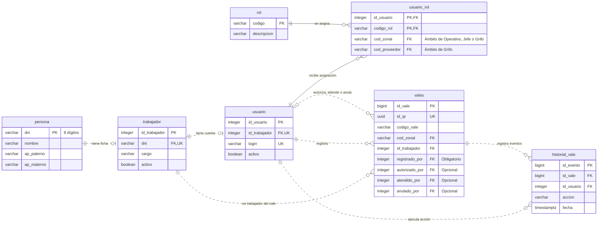
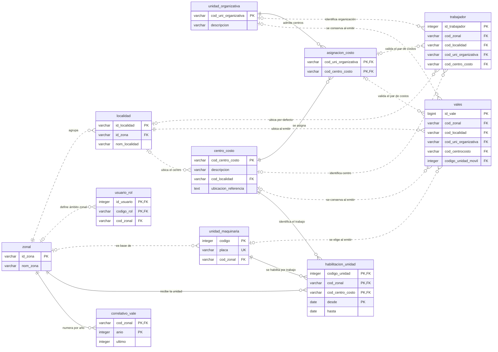
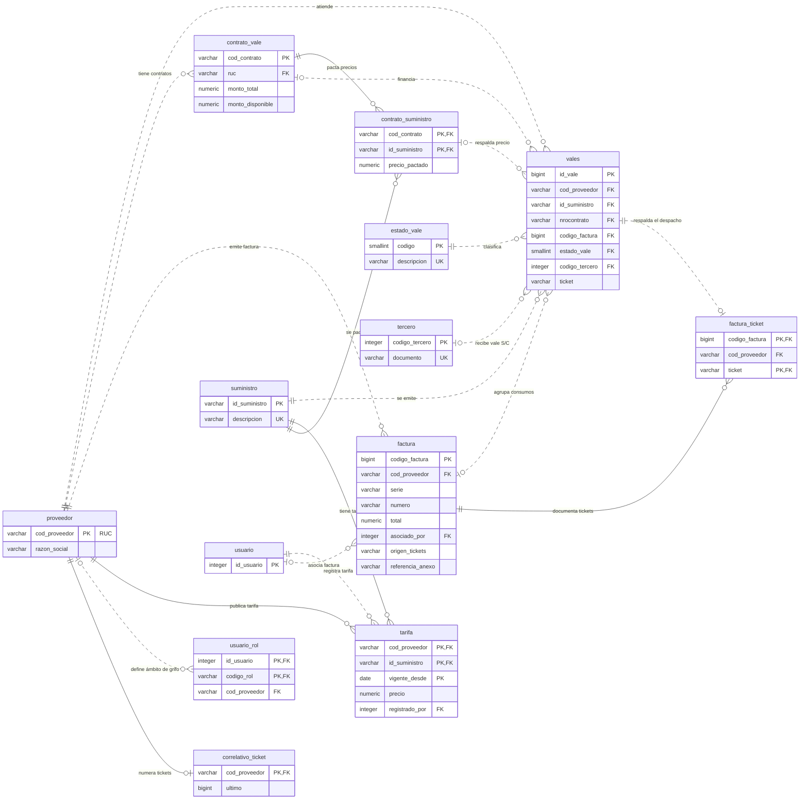

# Diagrama de la base de datos de vales

Los tres diagramas muestran las relaciones vigentes del esquema PostgreSQL de vales. [Administración](../backend/src/main/resources/db/migraciones/04-administracion.sql) añade el historial de cuentas y roles. La [migración de unidades móviles](../backend/src/main/resources/db/migraciones/12-unidad-movil-por-vale.sql) deja la asignación del vehículo en el vale.

**PK** indica clave primaria, **FK** indica clave foránea y **UK** indica unicidad. Varias columnas marcadas PK en una tabla forman una sola clave compuesta. Un círculo indica participación opcional. La pata de gallo indica que puede haber varias filas relacionadas.

## Personas, accesos y vales

Una persona puede tener una ficha de trabajador vinculada por DNI. Una ficha puede tener una cuenta. Toda cuenta pertenece a un trabajador y enlaza con su ficha por `id_trabajador`. La base admite como máximo una ficha por persona y una cuenta por ficha.

El trabajador emisor se identifica por `id_trabajador`. El vale exige que coincida con la ficha del usuario de `registrado_por`. Los responsables de registrar, autorizar, atender y anular se identifican por `id_usuario`. `registrado_por` siempre se guarda al emitir. Los otros responsables se completan según lo que ocurra con el vale. Cada evento de `historial_vale` conserva su vale, actor, acción y fecha.

Un usuario puede tener varios roles mediante `usuario_rol`. La clave es el par `(id_usuario, codigo_rol)`. Cada asignación de Operativo o Jefe requiere una zonal y cada asignación de Grifo requiere un proveedor y una zonal. Contabilidad y Administrador tienen asignaciones sin esos ámbitos. La columna `trabajador.cargo` describe el puesto laboral. Los permisos se determinan mediante `usuario_rol`.

## Ubicación, costo y maquinaria

Zonal y localidad son obligatorias en el vale y deben coincidir con el catálogo. Si la ficha del trabajador carece de localidad, se indica al emitir. Unidad organizativa y centro de costo son opcionales y, cuando ambos existen, su pareja se valida en `asignacion_costo`. Al emitir se propone el centro de la ficha y se puede elegir otro habilitado para la misma unidad organizativa. El vale conserva el centro y, si corresponde, la unidad móvil seleccionada. Una misma unidad puede aparecer en vales de diferentes trabajadores.

La unidad de otra zonal se acepta cuando una habilitación coincide con la zonal y el centro de costo del vale y está vigente en su fecha de emisión.

El centro de costo puede referenciar su localidad. La zonal de esa localidad se obtiene del catálogo. Cuando un dato heredado no identifica una localidad de forma inequívoca, se conserva como referencia de ubicación.

El correlativo de vale se guarda por `(cod_zonal, anio)`. La identidad interna es `id_vale` y la búsqueda por código de negocio se distingue mediante el par único `(cod_zonal, codigo_vale)`.

## Grifos, precios, tickets y facturas

Un vale corresponde a un grifo y a un combustible. Si tiene contrato, sus referencias validan tanto el grifo del contrato como el combustible pactado. S/C admite un tercero registrado o un trabajador cuando el grifo tiene un contrato vencido y ninguno vigente. La factura se asocia por `(codigo_factura, cod_proveedor)` y puede reunir varios vales usados del mismo grifo.

En las nuevas conciliaciones, `factura_ticket` identifica los despachos del respaldo del grifo. Se guarda su origen en la factura y la referencia cuando procede de un anexo. Los vínculos históricos se conservan.

El correlativo del ticket es por grifo. La unicidad corresponde al par `(cod_proveedor, ticket)`. Los estados vigentes son EMITIDO (0), AUTORIZADO (1), USADO (3) y ANULADO (4).
