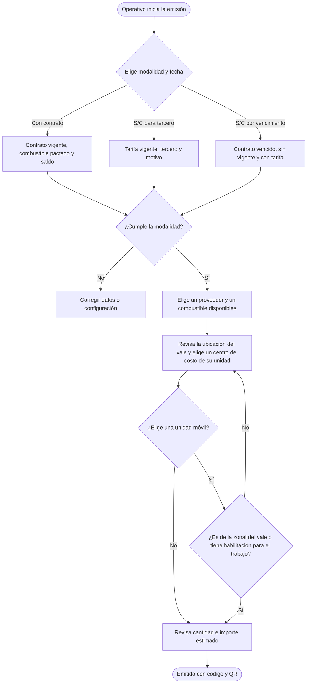
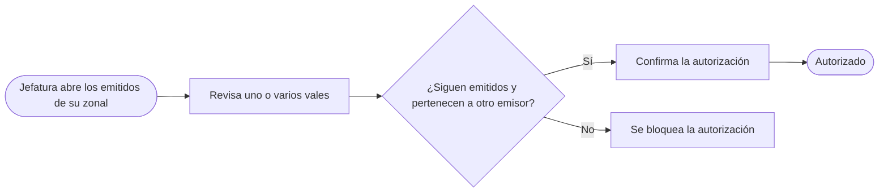
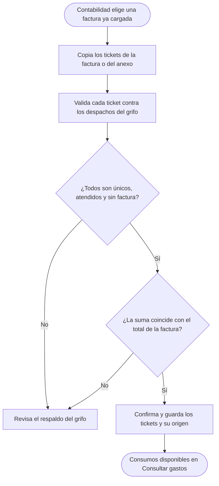

# Flujos de Vales

El estado del vale sigue la secuencia **Emitido → Autorizado → Usado**. El emisor puede anularlo antes del despacho. Vincular una factura conserva el estado **Usado**.

Los diagramas describen el comportamiento de la aplicación tras las migraciones 12 a 14.

## 1. Registrar vale

Un operativo puede tener varios vales emitidos o autorizados a la vez. La emisión con contrato reserva el importe estimado de cada vale y comprueba que haya saldo.

La localidad de la ficha se usa en la emisión cuando está registrada. Si falta, el operativo elige una localidad de su zonal. El centro habitual se propone desde la ficha y puede sustituirse por otro habilitado para la misma unidad organizativa. Cuando el centro tiene una localidad propia, se muestra por separado.

La unidad móvil es opcional y queda guardada en cada vale. Se muestran primero las unidades de la zonal del vale. Para elegir una de otra zonal, Administración debe haberla habilitado para esa zonal, el centro de costo elegido y la fecha de emisión. La zonal base de la unidad se muestra como un dato del catálogo.

## 2. Autorizar vales

Cada vale registra una sola autorización, incluso si hay varios jefes de la zonal. Si un vale del lote deja de ser elegible, se rechaza el lote.

## 3. Registrar atención

La tarifa de la fecha de consumo sugiere el precio real. Si falta tarifa, un vale con contrato puede usar el precio pactado como respaldo. El consumo no puede superar lo autorizado. Un despacho parcial también cierra el vale y libera la diferencia de la reserva cuando corresponde. El ticket identifica el despacho dentro de ese grifo.

## 4. Asociar factura

Los tickets se ingresan uno por línea. Si el origen es un anexo, también se registra su referencia. Una factura puede incluir consumos con contrato y S/C cuando su respaldo incluye ambos. Para facturas separadas se carga la lista correspondiente a cada una. Se compara el total final a dos decimales, sin desglose de IGV. Una diferencia o un ticket inválido bloquea la asociación. La asociación cerrada no admite agregar ni quitar vales.

## 5. Anular vale

La anulación guarda el motivo, el responsable y la fecha. Un vale usado permanece en el historial de atención.

## 6. PDF del vale y QR

La ficha pública muestra los cuatro datos del diagrama. El PDF completo requiere una cuenta con acceso al vale. El detalle y el PDF muestran por separado la localidad del centro de costo y la zonal base de la unidad cuando están registradas.

## 7. Consultar gastos

El consumo se incorpora al mes del despacho cuando queda asociado a una factura. Por ejemplo, un despacho de noviembre facturado en diciembre se consulta en noviembre.
