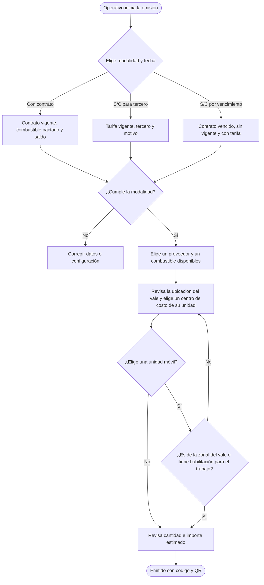
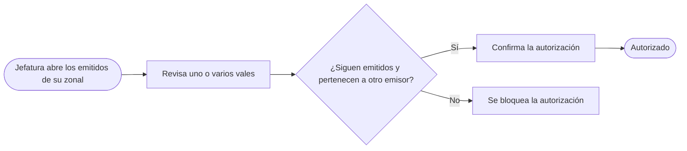
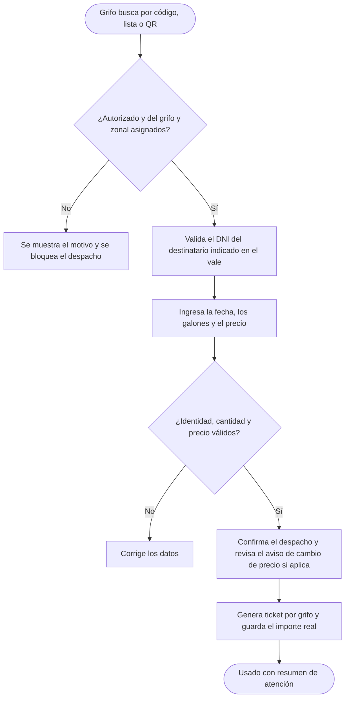
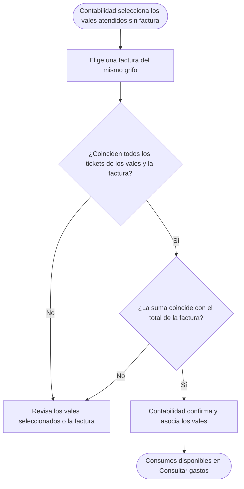
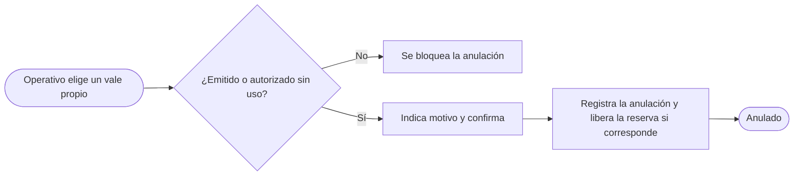
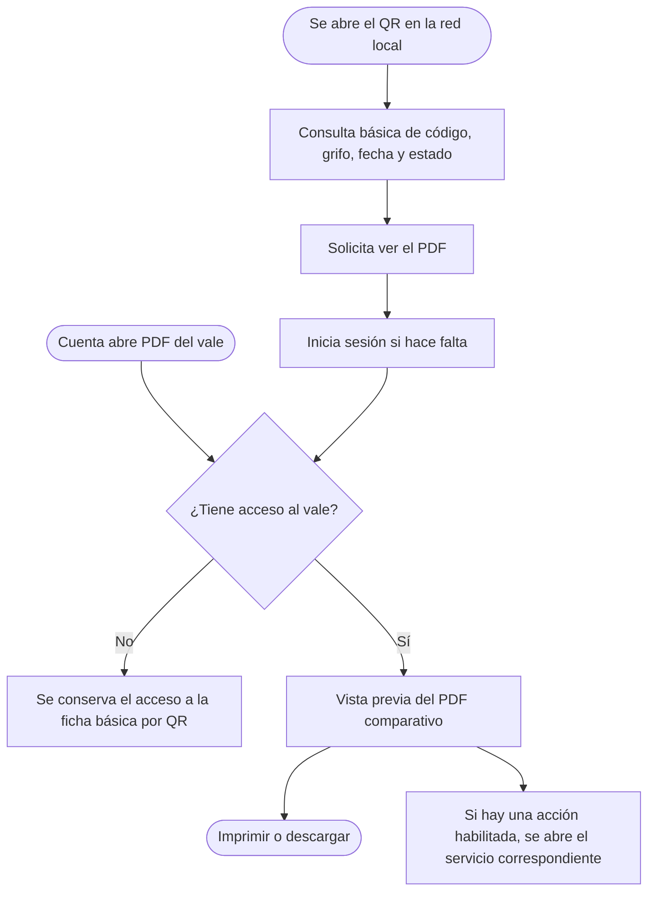
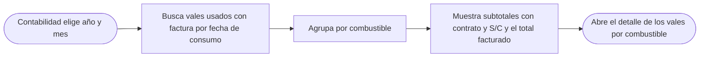
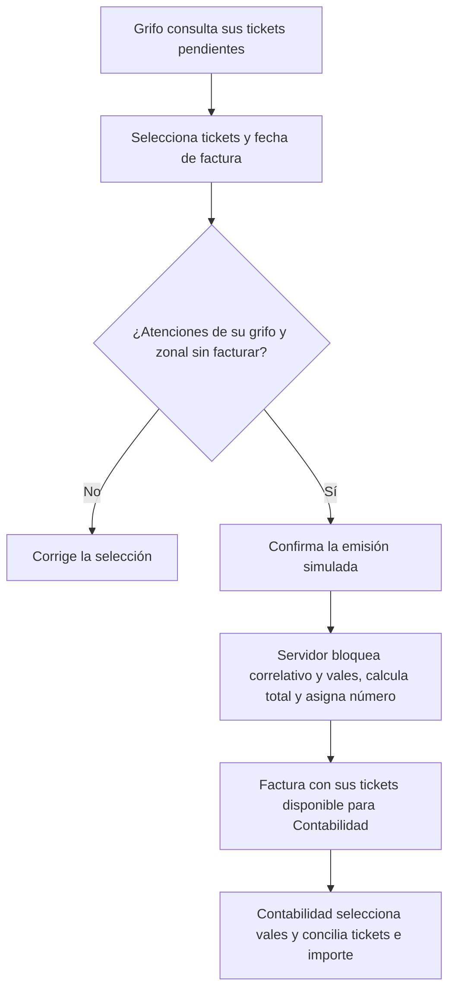

# Flujos de Vales

El estado del vale sigue la secuencia **Emitido → Autorizado → Usado**. El emisor puede anularlo antes del despacho. Vincular una factura conserva el estado **Usado**.

Los diagramas describen el comportamiento de la aplicación tras las migraciones 12 a 20.

## 1. Registrar vale

Un operativo puede tener varios vales emitidos o autorizados a la vez. La emisión con contrato reserva el importe estimado de cada vale y comprueba que haya saldo.

Antes de elegir el grifo, el operativo puede seleccionar una **ruta de trabajo asignada por Jefatura** y pulsar **Generar mejor opción**. El servidor compara el combustible solicitado y el desvío vial necesario para abastecerse entre los lugares de trabajo, respetando su orden. Se pueden tener varias rutas vigentes y cada ruta puede incluir varias paradas. La selección se aplica únicamente al pulsar Elegir grifo. Si se registra una ruta, el vale conserva su versión y el origen utilizados; editarlos posteriormente no cambia el documento anterior. El costo del desvío no se suma al importe del vale. [Detalle del flujo de rutas](rutas-trabajo.md).

La localidad de la ficha se propone en la emisión y puede elegirse otra localidad de la misma zonal. El centro habitual se propone desde la ficha y puede sustituirse por otro habilitado para la misma unidad organizativa. Cuando el centro tiene una localidad propia, se muestra por separado.

La unidad móvil es opcional y queda guardada en cada vale. Se muestran primero las unidades de la zonal del vale. Para elegir una de otra zonal, la jefatura de la zonal base debe haberla habilitado para esa zonal, el centro de costo elegido y la fecha de emisión. La zonal base de la unidad se muestra como un dato del catálogo.

## 2. Autorizar vales

La bandeja **Pendientes** permite buscar y filtrar por fecha de emisión, grifo y modalidad. Para autorizar uno, abre su detalle y pulsa **Autorizar vale**. Para varios, marca los vales y pulsa **Revisar selección**. La confirmación muestra los galones y el importe de cada vale, el total estimado y los vales que quedaron fuera del filtro. Puedes quitar vales antes de confirmar.

Cada vale registra una sola autorización con el responsable y la fecha. Si un vale cambia de estado mientras Jefatura revisa el lote, se rechaza la operación completa. Jefatura puede retirar ese vale, revisar el total actualizado y confirmar de nuevo.

## 3. Registrar atención

El grifo verifica el documento original del destinatario. Si el vale se emitió para un tercero, se exige el DNI de ese tercero. En los demás casos se exige el del trabajador asignado. Un DNI válido abre los datos del despacho.

La tarifa de la fecha de consumo sugiere el precio real. Si falta tarifa, un vale con contrato puede usar el precio pactado como respaldo. El consumo no puede superar lo autorizado. Un despacho parcial cierra el vale y libera la diferencia de la reserva cuando corresponde. El ticket identifica el despacho dentro de ese grifo. Si se interrumpe el guardado, la consulta del vale permite recuperar el ticket existente.

## 4. Asociar factura

El grifo selecciona sus tickets sin facturar y confirma una factura simulada. El servidor calcula el importe y asigna el siguiente número por grifo y serie dentro de una transacción. Los reintentos de la misma solicitud devuelven la misma factura. Las facturas anteriores de ejemplo conservan sus tickets y se consultan al elegirlas. El botón se habilita cuando coincide el conjunto completo de tickets y el total final a dos decimales. Una factura puede incluir consumos con contrato y S/C cuando contiene los tickets de ambos. La asociación cerrada conserva el vínculo de cada vale.

## 5. Anular vale

El operativo busca un vale propio emitido o autorizado. En el celular toca la tarjeta y en escritorio usa la acción **Anular vale**. Revisa la tarjeta con el motivo y confirma. El vale pasa a **Anulado** y queda disponible para consulta con el responsable, la fecha y el motivo.

## 6. PDF del vale y QR

La ficha pública muestra los cuatro datos del diagrama. El PDF completo requiere una cuenta con acceso al vale. El detalle y el PDF muestran por separado la localidad del centro de costo y la zonal base de la unidad cuando están registradas.

## 7. Consultar gastos

El consumo se incorpora al mes del despacho cuando queda asociado a una factura. Por ejemplo, un despacho de noviembre facturado en diciembre se consulta en noviembre.

## 8. Emitir factura simulada desde el grifo

Una factura puede reunir consumos con contrato y S/C del mismo grifo. También puede emitirse una factura separada por modalidad. Un ticket incluido en una factura emitida no puede facturarse otra vez ni asociarse a un documento distinto. La factura simulada no se envía a SUNAT.

## 9. Apoyos al registro y al control

- La consulta de DNI busca en el catálogo y luego en el proveedor externo si está configurado. El modo demostración identifica los datos ficticios. En atención se conserva la verificación del DNI esperado por el vale.
- La comparación de grifos considera solo opciones habilitadas. El traslado es una estimación de ida y vuelta en línea recta con costo por km indicado.
- El detalle y PDF comparten los datos actuales. El QR público muestra código, grifo, fecha y estado; los demás datos requieren sesión.
