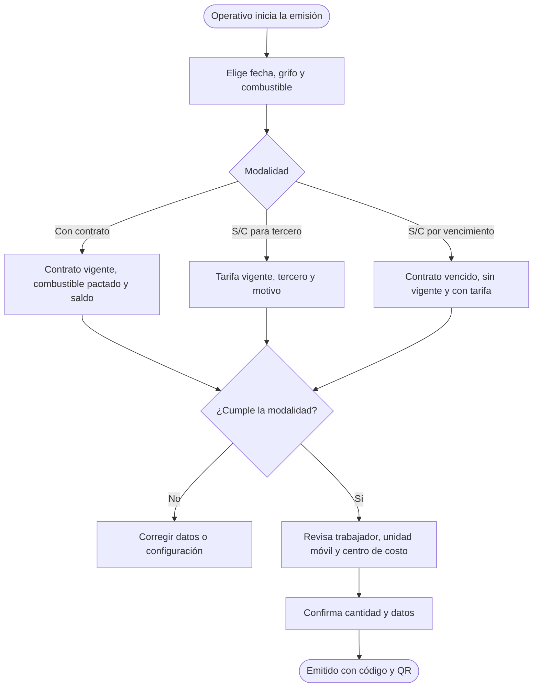
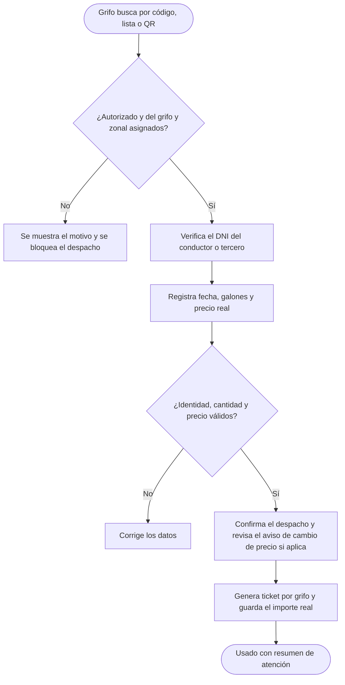
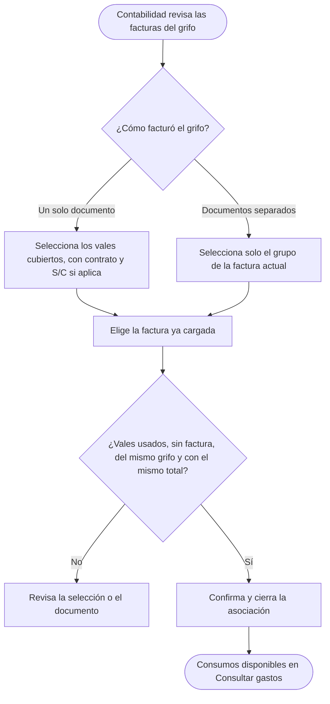
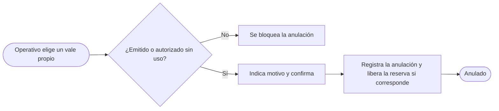
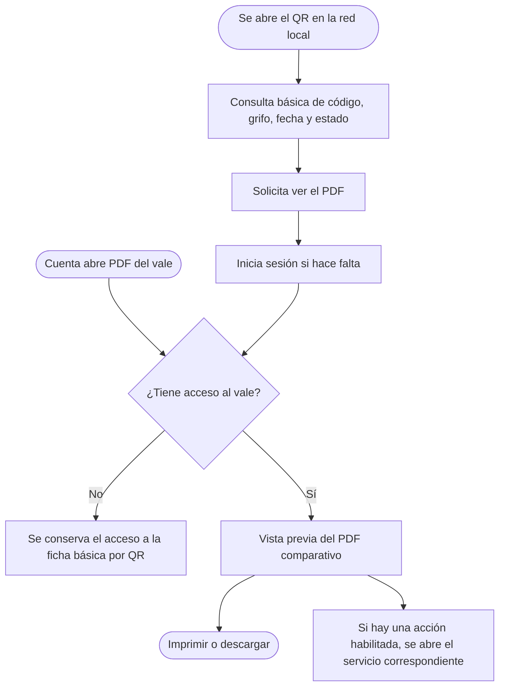
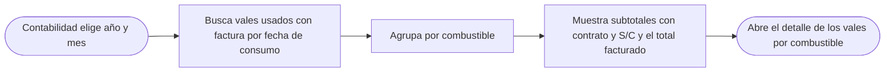

# Flujos de Vales

El estado del vale sigue la secuencia **Emitido → Autorizado → Usado**. El emisor puede anularlo antes del despacho. Vincular una factura conserva el estado **Usado**.

## 1. Registrar vale

El centro de costo se propone desde la ficha del trabajador. El operativo puede elegir otro de su misma unidad organizativa. La emisión con contrato reserva el importe estimado.

## 2. Autorizar vales

Cada vale registra una sola autorización, incluso si hay varios jefes de la zonal.

## 3. Registrar atención

La tarifa de la fecha sugiere el precio real. Si falta tarifa, un vale con contrato puede usar el precio pactado como respaldo. El consumo no puede superar lo autorizado. Un despacho parcial también cierra el vale y libera la diferencia de la reserva cuando corresponde.

## 4. Asociar factura

Por ejemplo, S/ 300 con contrato y S/ 80 S/C se pueden asociar a una factura de **S/ 380** que cubra ambos consumos. Si hay facturas de **S/ 300** y **S/ 80**, cada una se asocia a su grupo. Incluir el vale S/C en la de S/ 300 daría S/ 380 y bloquearía la asociación. Se compara el total final a dos decimales, sin desglose de IGV. La asociación cerrada no admite agregar ni quitar vales.

## 5. Anular vale

## 6. PDF del vale y QR

La ficha pública no entrega DNI. En el PDF, el grifo verifica el documento presentado y los perfiles habilitados pueden ver el DNI del trabajador.

## 7. Consultar gastos

El consumo se incorpora al mes del despacho cuando queda asociado a una factura.
